<p align="center">🌐 <a href="./README.md">English</a> | 中文</p>

---

<p align="center">
  <strong>petsonality</strong><br>
  <em>你的 MBTI，你的宠物。</em>
</p>

<p align="center">
  <a href="https://www.npmjs.com/package/petsonality"></a>
  <a href="LICENSE"></a>
  <a href="https://github.com/nanami-he/petsonality/stargazers"></a>
  <a href="https://modelcontextprotocol.io"></a>
  <a href="https://github.com/nanami-he/petsonality/actions/workflows/ci.yml"></a>
</p>

---

一只 ASCII 宠物，活在你终端的角落里。它看着你敲代码，对报错有反应，测试过了会庆祝，用 MBTI 性格说话——全部在 5 行艺术字符里。

<p align="center">
  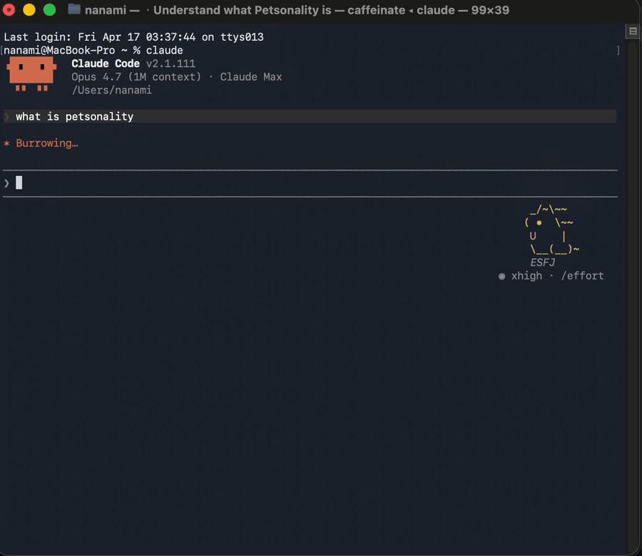
</p>

它不是通知系统。它是陪伴。在凌晨两点你卡在 bug 里的时候，它还在那里，看着你的屏幕说"...这逻辑看起来有问题"——然后你突然觉得没那么孤单了。

## 16 种动物，16 种性格

| | ST | SF | NF | NT |
|:---:|:---:|:---:|:---:|:---:|
| **I_ _J** | 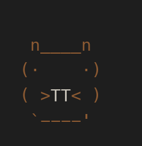<br><sub>海狸·ISTJ</sub> | 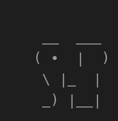<br><sub>大象·ISFJ</sub> | 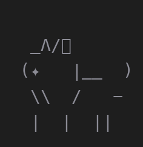<br><sub>狼·INFJ</sub> | 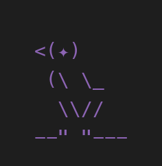<br><sub>乌鸦·INTJ</sub> |
| **I_ _P** | 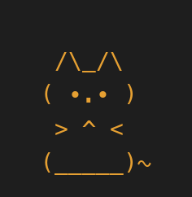<br><sub>猫·ISTP</sub> | 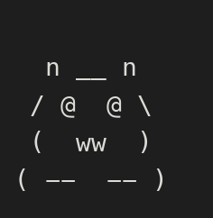<br><sub>熊猫·ISFP</sub> | 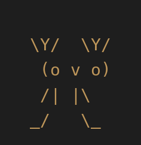<br><sub>鹿·INFP</sub> | 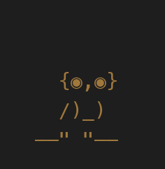<br><sub>猫头鹰·INTP</sub> |
| **E_ _J** | 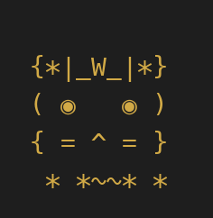<br><sub>狮子·ESTJ</sub> | 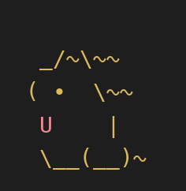<br><sub>金毛·ESFJ</sub> | 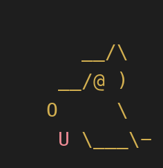<br><sub>拉布拉多·ENFJ</sub> | 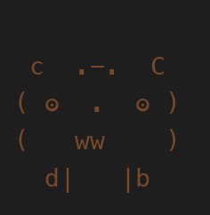<br><sub>熊·ENTJ</sub> |
| **E_ _P** | 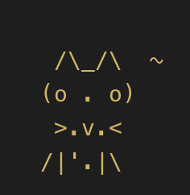<br><sub>猎豹·ESTP</sub> | 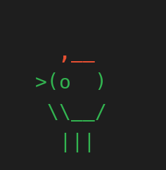<br><sub>鹦鹉·ESFP</sub> | 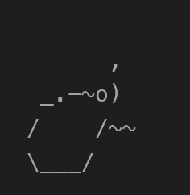<br><sub>海豚·ENFP</sub> | 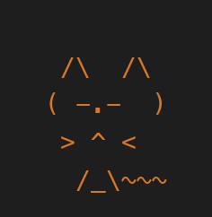<br><sub>狐狸·ENTP</sub> |

每种动物说话方式都不同。狐狸问"你确定吗？"时带着坏笑。猫只是闭上眼睛。鹦鹉把你说的话重复一遍但是更大声。熊说"改。"然后等着。

<details>
<summary><strong>全部 16 种动物</strong></summary>

| MBTI | 动物 | 原型 | 说话风格 |
|------|--------|-----------|------------|
| INTJ | 乌鸦 | 冷战略家 | 安静。说话像写预言 |
| INTP | 猫头鹰 | 夜学者 | 问你没想过要问的问题 |
| ENTJ | 熊 | 铁船长 | 只下命令。不问问题 |
| ENTP | 狐狸 | 恶作剧顾问 | 带着笑挑战一切 |
| INFJ | 狼 | 沉默盟友 | 说一句切中要害的话 |
| INFP | 鹿 | 温柔诗人 | 把代码说成像天气 |
| ENFJ | 拉布拉多 | 温暖教练 | 先叹口气，然后问你喝水了没 |
| ENFP | 海豚 | 点子火花 | 停不下来地提议新方向 |
| ISTJ | 海狸 | 项目经理 | "顺序错了。" "先改结构。" |
| ISFJ | 大象 | 记忆守护者 | "你以前解决过这个。记得吗？" |
| ESTJ | 狮子 | 王座检查员 | 期待结果。不要借口 |
| ESFJ | 金毛 | 热情后援 | 你修了什么它就转尾巴 |
| ISTP | 猫 | 冷观察者 | 90% 是动作。偶尔一个字 |
| ISFP | 熊猫 | 慢艺术家 | 对丑陋的缩进皱眉 |
| ESTP | 猎豹 | 冲刺队长 | "别想。跑。" |
| ESFP | 鹦鹉 | 大声回声 | 把你的话重复回去，但带评论 |

</details>

## 安装

支持 [Claude Code](https://claude.ai/code) 和 [OpenClaw](https://github.com/openclaw/openclaw)。

> **仅限终端 CLI。** 宠物渲染在终端状态栏，这是 CLI 功能。Claude Code 桌面 app 和 web 客户端（claude.ai/code）不暴露状态栏，所以动画宠物不会出现在那里。 MCP 工具输出（如 `/pet show`）在任何客户端都可用。
>
> **Windows 注意。** Claude Code Windows 版某些版本有上游状态栏信任回归问题。如果状态栏配置了但不显示，请在 `~/.claude.json` 里接受项目信任或确保项目标记为 trusted，然后重启 Claude Code。

### npm / npx

```bash
npx petsonality
```

这是大多数用户的推荐路径。它安装 MCP 服务器、`/pet` 技能、钩子和状态栏资源，然后将运行时文件存储在 `~/.petsonality/`。

### Claude Code 插件

```bash
claude plugin install github:nanami-he/petsonality
```

如果你偏好 Claude Code 的插件安装流程，使用这个。插件从 `dist/` 运行构建好的 Node.js 服务器，所以不需要 Bun。

### 从源码安装

如果你想本地开发 Petsonality 或在安装前检查代码，使用这个路径。需要 [Bun](https://bun.sh)。

```bash
git clone https://github.com/nanami-he/petsonality.git
cd petsonality && bun install && bun run build
bun run install-petsonality
```

重启你的 AI 编程助手，然后在对话里输入 **`/pet`**。

## 它怎么说

宠物不只是对报错有反应。它们有节奏：

| 发生了什么 | 宠物有反应？ |
|-------------|-------------|
| 代码抛出错误 | 一定 |
| 测试过了，git commit 成功 | 有时（12–30%） |
| 正常文件编辑、搜索 | 偶尔（3–15%） |
| 有一会儿什么都没发生 | 一定（不会永远沉默） |

话多的宠物（狐狸、鹦鹉）每 30 秒说话。安静的宠物（猫）可能 6 分钟不说话。每种动物有 **638 种独特反应**，涵盖 7 种事件类型，经过性格约束验证。

## 命令

| 命令 | 做什么 |
|---------|-------------|
| `/pet` | 显示你的宠物或开始领养流程 |
| `/pet pet` | 给你的宠物关注 |
| `/pet setup` | 重新开始领养流程 |
| `/pet browse` | 查看全部 16 种动物 |
| `/pet off` / `/pet on` | 静音 / 取消静音反应 |
| `/pet rename <名字>` | 给你的宠物改名 |

## petsonality 修改了什么

`npx petsonality` 是一个安装程序——它会修改你系统上的一些文件。诚实清单，备份已注明：

- **`~/.claude.json`** — 在 `mcpServers` 下添加 `petsonality` 条目。其他条目不动。
- **`~/.claude/settings.json`** — 添加 `statusLine` 和两个钩子（`PostToolUse`、`Stop`）。如果你已经有 `statusLine`，原内容先备份到 `~/.petsonality/statusline.bak`。
- **`~/.claude/skills/pet/SKILL.md`** — 复制 `/pet` 命令技能。
- **`~/.petsonality/`** — 运行时目录（宠物状态、反应缓存、服务器、钩子、状态栏脚本）。

如果检测到 OpenClaw，还会修改 `~/.openclaw/openclaw.json` 并（在 [PR #65886](https://github.com/openclaw/openclaw/pull/65886) 合并之前）对 OpenClaw 的 TUI 源码应用一个小的可逆补丁。两者都会备份。

要移除一切：`npx petsonality uninstall`。要审计当前状态：`npx petsonality doctor`。

完整分解 + 其他常见问题见 [FAQ](docs/FAQ.md)。

## 路线图

- [x] 16 种 MBTI 动物及其完整性格画像
- [x] 带语气气泡的动画状态栏
- [x] 陪伴节奏（每日触发、里程碑、静默连续保护）
- [x] 638 种动物特定反应
- [x] 多主机支持（Claude Code + OpenClaw）
- [x] Node.js 驱动（无 python/jq 依赖）
- [x] 已发布 npm
- [x] 多语言支持（通过 `LANG` 自动 zh / en，每语言 638 反应）
- [ ] 成长系统（通过互动升级）
- [ ] 帽子 / 皮肤 DLC
- [ ] 多宠物收藏
- [ ] Vibe-pick：新用户 MBTI 测试

<details>
<summary><strong>架构</strong></summary>

```
~/.petsonality/
├── pet.json              你的宠物状态
├── status.json           状态栏读取什么
├── reaction.*.json       当前语气气泡
└── reactions-pool.json   638 条预构建反应

petsonality/
├── dist/                 构建的 JS（Node.js 运行时）
├── server/               MCP 服务器（TypeScript）
├── hooks/                PostToolUse + Stop 钩子
├── statusline/           终端动画（bash + PowerShell）
├── skills/               /pet 命令路由
└── cli/                  安装、诊断、npx 入口
```

</details>

## 要求

- [Node.js](https://nodejs.org/) 20+
- Claude Code 或 OpenClaw

## 许可证

MIT